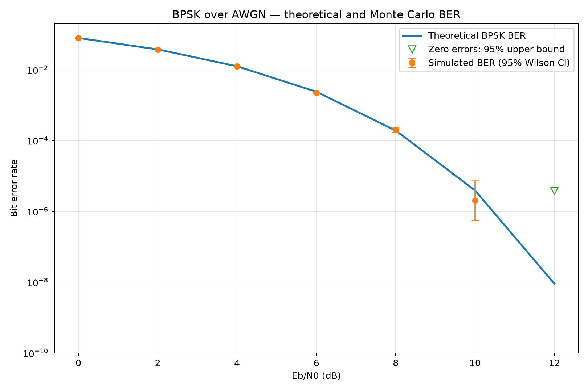

# CommuLab

A Python-based digital communication systems and numerical BER simulation laboratory.

## Project origin

This project is a redevelopment and extension of an unfinished 2023 academic
Communication Systems project investigating numerical approximations of the
Gaussian Q-function.

## Planned capabilities

- Numerical integration and Gaussian Q-function approximation
- Convergence, accuracy, and performance benchmarking
- BPSK, QPSK, and 16-QAM simulation
- AWGN channel modeling
- Theoretical and Monte Carlo BER comparison
- Interactive experiment dashboard

## Status

M00: Engineering foundation complete.

M01: Gaussian Q-function numerical analysis complete.

M02: BPSK/AWGN communication simulation implemented and validated with 159 automated tests.

M03: Gray-coded QPSK and 16-QAM, complex AWGN, theoretical BER, and Monte Carlo comparison implemented and validated locally with 299 automated tests. GitHub integration pending.

## Python

Python 3.12 or later is required.


## M02 - BPSK over AWGN

The communication simulator supports seeded BPSK modulation, real AWGN,
bounded-memory Monte Carlo BER analysis, theoretical comparison, and
95% Wilson confidence intervals.

Run the complete test suite:

```powershell
.\.venv\Scripts\python.exe -m pytest -q
```

Generate the BPSK BER experiment:

```powershell
.\.venv\Scripts\python.exe experiments\m02_bpsk_ber_sweep.py
```

See [M02 methodology and results](docs/M02_BPSK_AWGN_BER.md).



## M03 - QPSK and 16-QAM over AWGN

The simulator also supports Gray-coded QPSK and 16-QAM with
unit-average-symbol-energy normalization, complex AWGN, ideal
hard-decision demodulation, theoretical BER models, and reproducible
bounded-memory Monte Carlo estimation.

At equal Eb/N0, the comparison shows the BER and bits-per-symbol
tradeoff between QPSK and 16-QAM.

Generate the modulation comparison experiment:

```powershell
.\.venv\Scripts\python.exe experiments\m03_modulation_ber_comparison.py
```

The experiment processes 7,000,000 transmitted bits across 14
configurations and saves a CSV dataset and semilogarithmic BER plot.

See [M03 methodology and results](docs/M03_QPSK_16QAM_BER.md).


