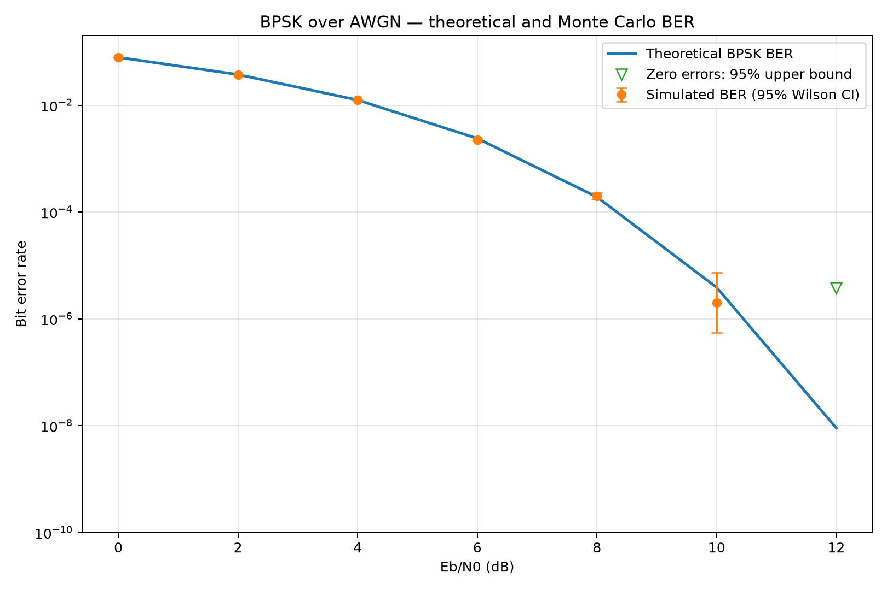

# M02 ? BPSK over AWGN: Monte Carlo BER Simulation

## Objective

Implement and validate a reproducible binary communication link that
compares simulated bit-error rates with theoretical predictions.

## Signal chain

1. Generate uniformly distributed binary bits using a seeded RNG.
2. Map bits to unit-energy BPSK symbols: 0 -> +1, 1 -> -1.
3. Add independent real Gaussian noise.
4. Recover bits using a zero-threshold hard decision.
5. Count bit errors and estimate the BER.
6. Compute theoretical BER and Wilson confidence intervals.

## Noise normalization

For real, unit-energy BPSK, Eb = 1.

The received signal is r = s + n, where:

- s is either -1 or +1.
- n follows a zero-mean Gaussian distribution.
- noise variance = 1 / (2 * 10^(Eb/N0_dB / 10)).

Theoretical coherent BPSK BER is:

P_b = Q(sqrt(2 * 10^(Eb/N0_dB / 10))).

The theoretical Q-function comes from the M01 numerical engine.

## Simulation design

The Monte Carlo implementation processes bits in bounded-size batches.

The signal-bit and noise generators use separate deterministic RNG
streams. Repeated experiments with the same configuration reproduce
their results.

The BER result records:

- Eb/N0 in dB
- Transmitted bits and observed bit errors
- Simulated BER
- Theoretical BER
- Random seed
- Lower and upper endpoints of a 95% Wilson confidence interval

The Wilson interval assumes independent Bernoulli bit-error events,
consistent with the memoryless BPSK/AWGN experiment.

## Reproducible BER sweep

Run from the project root:

```powershell
.\.venv\Scripts\python.exe experiments\m02_bpsk_ber_sweep.py
```

Experiment configuration:

- Eb/N0: 0, 2, 4, 6, 8, 10, 12 dB
- Bits per point: 1,000,000
- Batch size: 100,000
- Base seed: 2026, incremented for each point
- Total simulated bits: 7,000,000

Outputs:

- `experiments/results/m02/bpsk_ber_sweep.csv`
- `experiments/results/m02/bpsk_ber_sweep.png`



## Scientific observations

The measured BER generally follows the theoretical BER curve.

The original 6 dB sweep observed 2,237 errors per million bits,
compared with a theoretical expectation of approximately 2,388 errors.
Its two-sided 95% Wilson interval did not contain the theoretical BER.

Five additional, independently seeded 6 dB simulations were run:

| Seed | Errors per 1,000,000 bits |
| --- | ---: |
| 3101 | 2363 |
| 3102 | 2391 |
| 3103 | 2401 |
| 3104 | 2455 |
| 3105 | 2347 |

The five-run pooled estimate was 11,957 / 5,000,000 = 0.0023914.
The theoretical BER is approximately 0.0023882908.
The standardized deviation of the pooled estimate was 0.142.

These findings are consistent with Monte Carlo sampling variation.
A confidence interval need not contain the true parameter on every run.

At 12 dB, no bit errors were observed among 1,000,000 bits.
This does not imply that the true BER is zero. The theoretical
probability is approximately 9.006e-9.

The green marker on the plot represents the upper endpoint of a
two-sided 95% Wilson confidence interval, not the simulated BER.

## Verification

At the M02-E2 checkpoint:

- 159 automated tests passed.
- Ruff checks passed.
- mypy checks passed.
- The BER sweep generated seven CSV records and one PNG.
- The graph was visually reviewed.
- An additional five-run 6 dB verification was completed.

## Limitations

- Current modulation support is BPSK only.
- Channel noise is real-valued AWGN, normalized for unit-energy BPSK.
- Monte Carlo results have finite-sample uncertainty.
- Large experiments still require processing time proportional
  to the transmitted bit count.
- Wilson intervals assume independent bit errors.
- The experiment does not model synchronization errors, fading,
  coding, frequency offsets, or hardware impairments.
- Very low theoretical BER can require prohibitively many bits
  for direct Monte Carlo validation.
