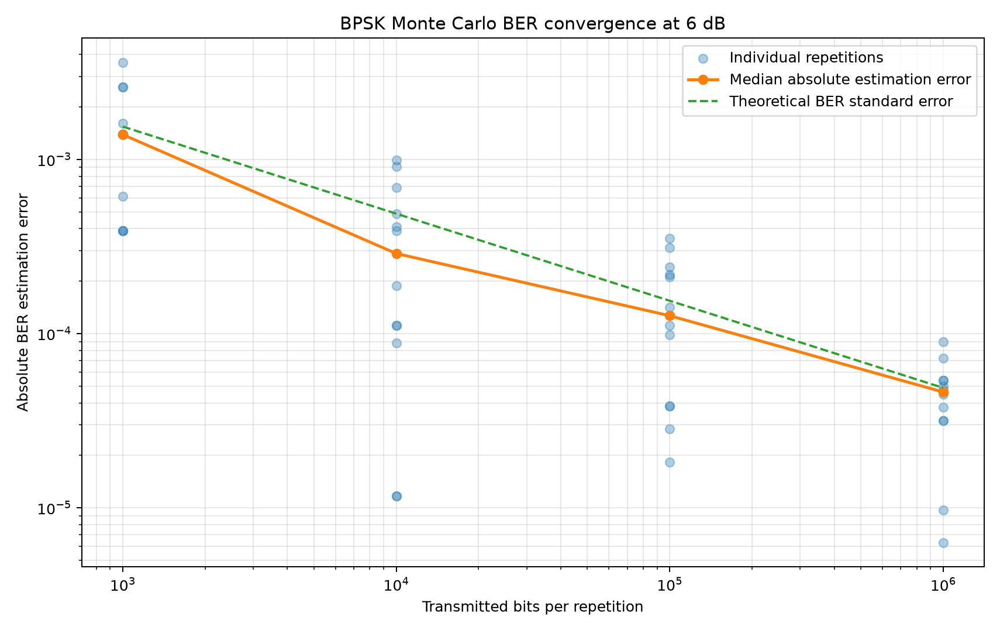
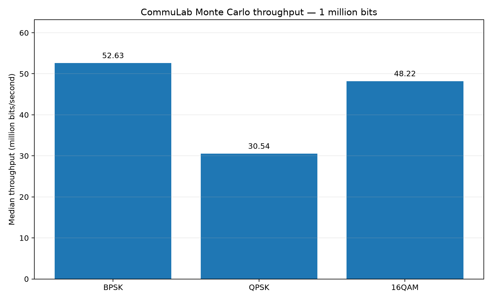
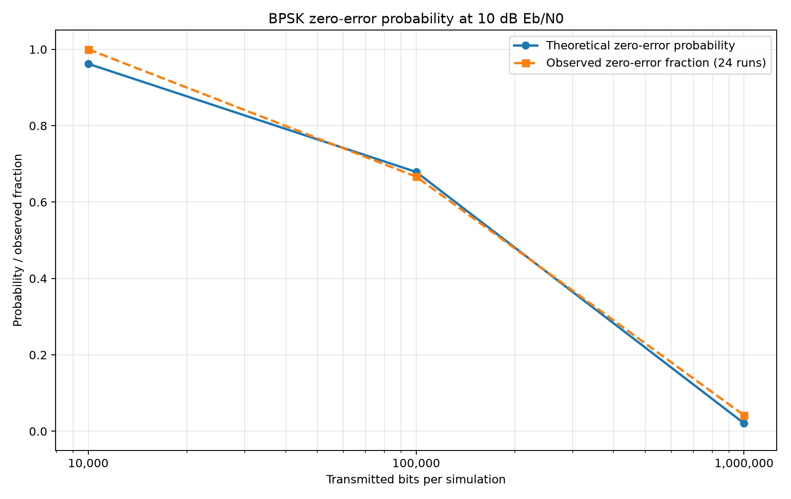

# M04 ? Statistical Reliability and Performance Benchmarking

## Status

Experiments validated locally. GitHub integration pending.

## Objective

Evaluate Monte Carlo BER convergence, implementation-level performance,
and rare-error statistical reliability without changing the established
BPSK, QPSK, and 16-QAM communication models.

## 1. Monte Carlo BER convergence

The experiment uses BPSK at Eb/N0 = 6 dB, 12 independently seeded
repetitions per bit count, and bounded batches of 50,000 bits.

Tested bit counts: 1,000; 10,000; 100,000; 1,000,000.
Total: 48 simulation runs and 13,332,000 transmitted bits.

The theoretical BER is approximately 0.002388290781.

| Bits/run | Mean simulated BER | Median absolute error | Median Wilson width | Theory within interval |
| ---: | ---: | ---: | ---: | ---: |
| 1,000 | 0.0027500 | 1.388e-03 | 6.714e-03 | 11/12 |
| 10,000 | 0.0022833 | 2.883e-04 | 1.936e-03 | 11/12 |
| 100,000 | 0.0024658 | 1.267e-04 | 6.121e-04 | 10/12 |
| 1,000,000 | 0.0024192 | 4.621e-05 | 1.930e-04 | 12/12 |

For independent Bernoulli errors, the theoretical standard error is

    sqrt(p * (1 - p) / N)

and decreases proportionally to 1/sqrt(N).

Increasing sample size reduces typical uncertainty but does not
guarantee that every individual estimate improves monotonically.
Coverage counts over 12 repetitions are descriptive, not a
certification of nominal 95% coverage.



Detailed results:
`experiments/results/m04/bpsk_convergence_runs.csv`

## 2. Simulator throughput

A single-process, wall-clock benchmark uses BPSK, QPSK and 16-QAM,
100,000 and 1,000,000 transmitted bits, and three timed repetitions
per configuration.

The implementations are warmed up before timing. Batch capacity is
approximately 100,000 bits, adjusted to complete modulation symbols.
Each run uses 6 dB Eb/N0.

Total: 18 timed runs and 9,900,000 timed transmitted bits.

| Modulation | Bits/run | Median seconds | Median million bits/s |
| --- | ---: | ---: | ---: |
| BPSK | 100,000 | 0.002261 | 44.23 |
| BPSK | 1,000,000 | 0.019002 | 52.63 |
| QPSK | 100,000 | 0.003521 | 28.40 |
| QPSK | 1,000,000 | 0.032739 | 30.54 |
| 16QAM | 100,000 | 0.002475 | 40.40 |
| 16QAM | 1,000,000 | 0.020738 | 48.22 |

Measurements include Python, NumPy, random-number generation,
mapping, AWGN, demapping, error counting, and result construction.
They do not represent physical radio throughput or a theoretical
spectral-efficiency ranking.

Timings are machine- and environment-specific. Three repetitions
are insufficient for a universal performance ranking.



Detailed results:
`experiments/results/m04/modulation_throughput_runs.csv`

## 3. Rare-error reliability

The experiment uses coherent BPSK at 10 dB Eb/N0, with theoretical
BER approximately 3.872108215522e-6.

For N independent transmitted bits, the probability of observing
zero errors is:

    P(K = 0) = (1 - p)^N

The experiment runs 24 independent seeds at each of three bit counts:
10,000; 100,000; and 1,000,000.

Total: 72 runs and 26,640,000 transmitted bits.

| Bits/run | Zero-error runs | Theoretical P(zero) | 95% Wilson upper bound for zero errors | Theory within interval |
| ---: | ---: | ---: | ---: | ---: |
| 10,000 | 24/24 | 96.2019% | 3.839984e-04 | 24/24 |
| 100,000 | 16/24 | 67.8947% | 3.841311e-05 | 23/24 |
| 1,000,000 | 1/24 | 2.0814% | 3.841444e-06 | 20/24 |

Zero observed errors do not imply a true BER of zero. The
two-sided 95% Wilson interval gives a positive upper bound.

At one million bits, the zero-error upper bound is approximately
3.841444e-6, slightly below the theoretical 3.872108e-6.
Thus the zero-error interval misses the theoretical value.

Observed coverage of 20/24 at one million bits is an exploratory
observation, not an accurate estimate of long-run coverage.
Rare-event coverage can be discrete and depends on the interval
construction, true probability and sample size.



Detailed results:
`experiments/results/m04/rare_error_runs.csv`

## 4. Reproduction

From the repository root:

```powershell
.\.venv\Scripts\python.exe experiments\m04_ber_convergence.py
.\.venv\Scripts\python.exe experiments\m04_modulation_throughput.py
.\.venv\Scripts\python.exe experiments\m04_rare_error_reliability.py
```

The convergence and rare-error experiments use recorded deterministic
seeds. Wall-clock benchmark timings vary by computer, environment,
system load, and runtime conditions.

Generated CSV files include detailed observations and summary tables.

## 5. Validation and limitations

Local acceptance established:

- 299 automated tests passed.
- Ruff passed for source, tests and experiments.
- mypy passed for 16 source files.
- Dependency integrity checks passed.
- All three experiment families completed and produced CSV/PNG artifacts.

The BER models assume ideal uncoded transmission over AWGN.
Confidence intervals assume independent Bernoulli bit errors.
The experiments do not measure RF hardware performance, fading,
channel coding, or real-world link throughput.
